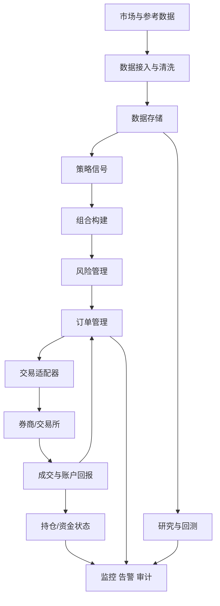
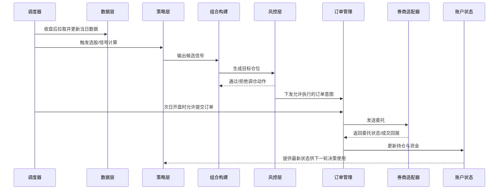

# 饕餮系统架构设计

## 1. 设计目标

`饕餮` 的首版目标是构建一个个人可控、低频优先、只覆盖研究与回测闭环的量化交易系统。

这份架构文档要解决的不是“选哪只股票”，而是明确：

- 系统由哪些模块组成
- 模块之间如何协作
- 哪些能力是首版必须的
- 哪些复杂能力明确延后

## 2. 非目标

首版不追求以下能力：

- 高频或超低延迟交易
- 多账户清分和机构级权限体系
- 复杂衍生品定价与风险引擎
- 自研撮合器或交易所级基础设施
- 覆盖所有市场差异的统一平台

## 3. 核心原则

### 3.1 一个策略，尽量贯穿研究、回测、模拟盘和实盘

首版系统要尽量复用同一套策略接口，减少“研究用一套、回测用一套、实盘再重写一套”的情况。

### 3.2 市场差异放到适配层

通用架构负责稳定的抽象，例如行情、订单、持仓、账户、风险规则。

A 股、数字货币、期货等差异放在数据适配器和交易适配器层中，而不是写死在策略代码里。

### 3.3 风控必须独立于策略

策略负责生成机会，风控负责限制损失和异常暴露。

如果把风控写进每个策略里，系统会很快变得不可维护。

### 3.4 优先事件驱动，而不是脚本拼接

系统内部的关键状态变化都应该被视为事件：

- 新行情到达
- 信号生成
- 风险检查通过或拒绝
- 订单提交
- 成交回报
- 账户与持仓更新

事件驱动的好处是：研究、回测、模拟盘、实盘可以共享更一致的运行模型。

### 3.5 研究闭环内部也要分层

首版虽然只做到研究与回测，但研究内部也不能把历史数据、因子值、未来标签、因子评估和选股规则混成一团。

如果研究阶段不先把这些概念拆开，后面就会出现两个问题：

- 结果不可解释，不知道因子为什么有效、股票为什么被选中
- 研究与回测耦合过深，后续想替换标签口径或评估方法时只能重写策略

## 4. 逻辑架构



### 4.1 首版研究子系统的内部主链路

从完整量化系统视角，`研究与回测` 只是总架构中的一个模块。

但从首版 MVP 视角，这个模块内部还应继续拆成一条更明确的研究链路：

```text
标准化历史数据
-> 候选因子生成
-> 未来表现标签定义
-> 因子有效性评估
-> 选股规则沉淀
-> 回测验证
-> 研究报告输出
```

这里的重点不是新增一批独立服务，而是要求首版在方法上保持分层：

- 因子生成回答“看什么特征”
- 标签定义回答“拿什么未来结果做验证”
- 因子评估回答“这个特征是否真的有用”
- 选股规则回答“如何把有效因子转成当期信号”
- 回测回答“这套规则放进历史交易流程后表现如何”

## 5. 模块清单

下面是 `饕餮` 的完整目标架构模块边界。注意：这些模块不都属于首版 MVP。

### 5.1 市场与参考数据层

#### 1) 行情数据接入

- 职责：接入日线、分钟线、盘口快照等行情数据
- 输入：外部数据源的原始行情
- 输出：统一格式的行情事件或行情表
- 首版是否必须：是

#### 2) 参考数据接入

- 职责：接入交易日历、标的基础信息、行业分类、指数成分等参考信息
- 输入：交易所、数据商、公开接口等外部数据
- 输出：统一格式的参考数据
- 首版是否必须：是

#### 3) 数据清洗与标准化

- 职责：统一代码、时间戳、缺失值和字段命名
- 输入：原始行情与参考数据
- 输出：标准化后的内部数据模型
- 首版是否必须：是

#### 4) 数据存储

- 职责：为研究、回测、模拟盘和实盘提供一致的数据读取能力
- 输入：清洗后的市场与参考数据
- 输出：按时间、标的、字段可查询的数据集
- 首版是否必须：是

### 5.2 研究与回测层

#### 5) 策略研究环境

- 职责：支持快速实验因子、指标和交易规则
- 输入：标准化后的历史数据
- 内部链路：候选因子生成 -> 未来表现定义 -> 因子评估 -> 选股规则沉淀
- 输出：策略原型、指标结果、研究结论
- 首版是否必须：是

#### 6) 回测引擎

- 职责：用历史数据重放策略运行过程，输出收益和风险指标
- 输入：历史行情、参考数据、策略逻辑、交易成本假设
- 输出：收益曲线、交易记录、回撤、换手率、风险指标
- 首版是否必须：是

#### 7) 分析与复盘

- 职责：解释回测和运行结果，而不是只展示收益
- 输入：回测结果、实盘日志、订单与成交明细
- 输出：报表、异常结论、复盘记录
- 首版是否必须：是

### 5.3 决策层

#### 8) 标的池与信号生成

- 职责：筛选当前可交易标的，并把已验证的研究规则转换成买卖候选信号
- 输入：行情、参考数据、策略参数、当前状态
- 输出：候选交易信号
- 首版是否必须：是

#### 9) 组合构建

- 职责：把候选信号转成目标仓位
- 输入：候选信号、当前持仓、账户资金、约束条件
- 输出：目标持仓或目标调仓动作
- 首版是否必须：是

#### 10) 风险管理

- 职责：在订单生成前做统一的风险过滤和限制
- 输入：目标仓位、账户状态、风险规则
- 输出：通过风控的调仓动作，或被拒绝的原因
- 首版是否必须：是

### 5.4 执行层

#### 11) 订单管理

- 职责：把调仓动作转成订单，并跟踪订单生命周期
- 输入：通过风控的调仓动作
- 输出：订单、撤单请求、订单状态变更
- 首版是否必须：是

#### 12) 交易适配器

- 职责：把内部统一订单模型转换为具体券商或交易接口协议
- 输入：内部订单对象
- 输出：真实下单请求、撤单请求、成交回报、账户同步结果
- 首版是否必须：是

#### 13) 账户与持仓状态

- 职责：记录可用资金、冻结资金、持仓数量、成本和盈亏
- 输入：成交回报、账户回报、风控占用、手工调整
- 输出：最新账户快照和持仓快照
- 首版是否必须：是

### 5.5 保障层

#### 14) 运行调度

- 职责：在正确的时间触发收盘选股、开盘下单、盘中监控、收盘复盘
- 输入：交易日历、系统配置、定时任务
- 输出：任务触发事件
- 首版是否必须：是

#### 15) 日志、指标、告警

- 职责：跟踪系统健康状态和关键业务状态
- 输入：系统事件、错误、延迟、订单状态、风控结果
- 输出：日志、监控指标、告警通知
- 首版是否必须：是

#### 16) 配置与参数管理

- 职责：管理数据源配置、策略参数、风控阈值和运行环境差异
- 输入：环境配置、策略版本、运行参数
- 输出：可追踪的配置快照
- 首版是否必须：是

## 6. 关键数据流

### 6.1 从数据到交易的主链路

```text
市场数据 -> 数据标准化 -> 策略信号 -> 目标仓位 -> 风险检查
-> 生成订单 -> 券商/交易接口 -> 成交回报 -> 账户与持仓更新
```

### 6.2 首版研究与回测闭环

首版真正要先跑通的是研究链路，而不是交易链路：

```text
标准化历史数据 -> 候选因子 -> 未来表现标签 -> 因子评估
-> 选股规则/策略信号 -> 回测 -> 研究报告
```

这条链路与总架构并不冲突，而是对 `研究与回测` 模块的进一步展开。

### 6.3 从结果回到研究的复盘链路

```text
订单与成交记录 -> 运行日志 -> 绩效指标 -> 异常分析 -> 策略或风控修正
```

这两条链路必须闭环，否则系统只能“下单”，不能“进化”。

## 7. 一次典型运行时序

以下时序以“收盘后生成计划，次日执行”为例：



## 8. 首版 MVP 范围

### 8.1 首版必须完成

- 数据接入
- 数据标准化与存储
- 因子研究驱动的策略信号生成
- 历史数据驱动的基础回测

首版目标只要求完成“数据 -> 信号 -> 回测结果”的闭环，不要求具备真实运行能力。

进一步说，研究侧内部至少要能走通：

- 候选因子生成
- 未来标签定义
- 因子有效性评估
- 选股规则沉淀

这 4 步先作为研究层内部流程存在，不急着拆成独立服务。

### 8.2 可以延后

- 组合构建
- 风险管理
- 订单管理
- 交易适配器
- 账户与持仓状态
- 运行调度
- 日志、指标、告警
- 配置与参数管理
- 多市场统一接入
- 自动调参平台
- 大规模分布式回测
- 实时因子流式计算

## 9. 推荐的首版服务拆分

为了避免一开始过度设计，首版建议只围绕研究和回测闭环组织实现：

- `data-service`
  负责数据接入、清洗、落库和查询
- `strategy-runtime`
  负责策略计算和信号生成
- `backtest-engine`
  负责历史回放、收益计算和回测报告

如果项目规模还很小，也可以先合并成单体应用，但内部模块边界要保持一致。执行层和运维层不是首版必须项，不要提前实现。

## 10. 对实现者的约束

接下来进入编码阶段时，任何实现都不应破坏以下约束：

- 策略逻辑不得直接操作券商 API
- A 股特殊规则不得散落在策略代码中
- 风控规则不得依赖手工插入到单个策略里
- 订单状态必须可追踪，可重放，可复盘
- 研究、回测、模拟盘、实盘尽量共享同一套核心对象模型

## 11. 参考资料

- QuantConnect Algorithm Framework Overview: https://www.quantconnect.com/docs/v1/algorithm-framework/overview
- QuantConnect Risk Management: https://www.quantconnect.com/docs/v1/algorithm-framework/risk-management
- Freqtrade Introduction: https://www.freqtrade.io/en/stable/
- Freqtrade Protections: https://www.freqtrade.io/en/stable/plugins/#protections
- NautilusTrader Architecture: https://nautilustrader.io/docs/latest/concepts/architecture/
- NautilusTrader Adapters: https://nautilustrader.io/docs/latest/concepts/adapters/
