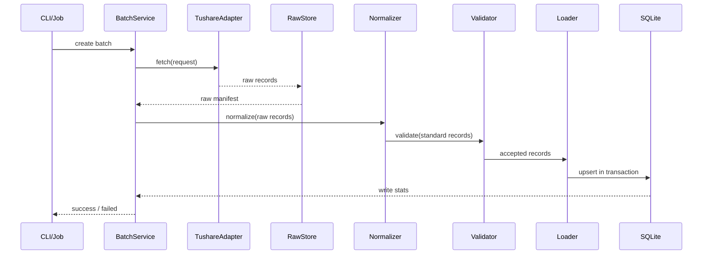

# 首版数据接入与标准化存储详细设计

## 1. 文档目标

这份文档是对 [06-数据接入与标准化存储方案](./06-数据接入与标准化存储方案.md) 的实现级补充，目标是把首版 MVP 中这两个模块讲到可直接开工：

1. 数据接入
2. 数据标准化与存储

文档要直接回答以下问题：

- 首版用什么技术栈实现
- 首版标准层落到哪个数据库
- 每类数据接哪个主数据源
- adapter、批次管理、原始层、标准化、入库各自怎么拆
- 各模块之间如何交互
- 增量同步、重刷、失败重试、数据校验如何处理

## 2. 设计前提

这份详细设计在以下已锁定前提下成立：

- 首版只做 `Stock`、`TradingCalendar`、`DailyQuote`
- 首版只服务研究、策略信号、回测，不服务实盘
- 首版只做离线批处理，不做实时流
- 首版不做多源仲裁，不做主备自动切换
- 首版不做复权计算，默认以前复权价格存储，不做交易状态模型
- 首版策略与回测只允许读取标准层

为了避免把 A 股边界偷偷放大，首版再补一条明确约束：

- 首版股票范围先锁定 `SSE` + `SZSE` 普通 A 股，不含北交所、不含基金、不含指数

这样做的目的不是否认后续扩展，而是避免在第一阶段就把 lot size、价格限制和板块差异重新引回数据底座。

## 3. 首版技术栈定案

## 3.1 技术栈选择原则

首版技术栈只追求三件事：

- 离线批处理实现简单
- 原始层到标准层可靠、可重跑
- 后续研究与回测读取成本低

因此首版不引入：

- Airflow
- Kafka
- Redis
- ClickHouse
- 对象存储服务
- 多语言拆分服务架构

## 3.2 最终选择

| 类别 | 选择 | 用途 |
| --- | --- | --- |
| 运行时语言 | Python 3.12 | 实现 adapter、标准化流水线、数据集构建、回测底座 |
| 包管理 | `uv` | 管理虚拟环境和依赖 |
| CLI | `Typer` | 提供同步和重刷命令入口 |
| 数据模型校验 | `Pydantic 2` | 定义标准化输入输出对象和参数校验 |
| 表级转换 | `Polars` | 处理批量记录清洗和类型转换 |
| 数据库访问 | Python 标准库 `sqlite3` | 访问本地 SQLite 数据文件 |
| schema 初始化 | 版本化 SQL 脚本 | 初始化和升级本地库结构 |
| 标准层数据库 | SQLite 3 | 存标准表和元数据表 |
| 原始层存储 | 本地文件系统 | 落原始 JSONL / manifest |
| 测试 | `pytest` | 单测和回归测试 |

## 3.3 为什么是这套组合

### 1) 运行时统一用 Python

原因很直接：

- 数据接入、批量清洗和回测底座更适合在同一运行时里完成
- 仓库当前只有极轻量的 Python 模块骨架，尚未存在既定 TypeScript 工程约束
- 首版重点是离线数据链路，而不是对外 API 或前端应用

`07` 中的 TypeScript 接口定义仍然保留为“应用层契约表达方式”，不强制意味着首版运行时必须用 TypeScript。

### 2) 标准层用 SQLite

原因：

- 你当前的运行环境是本地单机，单文件数据库比独立数据库服务更轻
- 首版标准层仍然需要唯一键、事务、幂等 upsert、批次元信息和质量问题记录
- SQLite 已经足够支撑 `stock`、`trading_calendar`、`daily_quote` 这几个首版核心表
- 不需要额外安装、启动和维护数据库服务

### 3) 原始层落本地文件

原因：

- 原始层本质上是“保留抓取证据和重放素材”，没必要先塞进数据库
- 首版没有多机部署要求，不必提前引入对象存储

## 4. 存储分层定案

## 4.1 分层总览

```text
外部数据源
-> adapter
-> Raw Layer（文件）
-> Normalize + Validate
-> Standard Layer（SQLite）
```

## 4.2 Raw Layer

用途：

- 保存原始响应或原始记录
- 支持标准化逻辑重跑
- 支持按批次排查问题

目录约定：

```text
data/raw/{source_name}/{resource_type}/ingest_date={yyyy-mm-dd}/ingestion_batch_key={batch_key}/
  manifest.json
  records.jsonl
```

约束：

- 每个批次一个独立目录
- `manifest.json` 必须先写入批次元信息，再写记录文件路径和校验摘要
- 原始记录至少保留 `source_record_key`、`fetched_at`、`payload`

目录里实际放的数据：

- `manifest.json`：这一批抓取的说明文件
- `records.jsonl`：逐条原始记录，便于排错和回放

`manifest.json` 示例：

```json
{
  "ingestion_batch_id": 42,
  "batch_key": "daily_quote_2026-09-03_001",
  "source_name": "tushare_pro",
  "resource_type": "daily_quote",
  "sync_mode": "incremental",
  "request_params": {
    "trade_date": "2026-09-02"
  },
  "started_at": "2026-09-03 18:01:02",
  "finished_at": "2026-09-03 18:01:08",
  "row_count_raw": 5231,
  "status": "success"
}
```

`records.jsonl` 单行示例：

```json
{"source_record_key":"600519.SH:2026-09-02","fetched_at":"2026-09-03 18:01:05","payload":{"ts_code":"600519.SH","trade_date":"20260902","open":1432.0,"high":1450.0,"low":1428.5,"close":1444.2,"vol":32145.67,"amount":463829.12}}
```

说明：

- `payload` 保留源接口原始字段，不提前改名
- Raw Layer 是“证据层”，不是策略直接读取的数据层
- 首版 Raw Layer 只保留一种原始记录格式，避免双写和重复记账

## 4.3 Standard Layer

用途：

- 作为内部唯一可信数据源
- 提供强约束、强一致的表结构
- 承接批次、质量校验和 upsert

物理形态：

- 单个 SQLite 文件，例如 `data/system/glutton.db`
- 不使用数据库 schema，直接使用普通表名

表分两组逻辑对象：

- 元数据表：`ingestion_batch`、`data_quality_issue`
- 标准表：`stock`、`trading_calendar`、`daily_quote`

SQLite 运行约定：

- 开启 `WAL` 模式
- 开启 `foreign_keys = ON`
- 时间字段统一存 `yyyy-MM-dd HH:mm:ss` 格式字符串，按 `Asia/Shanghai` 本地时间解释
- JSON 字段统一存 JSON 字符串，不依赖 `jsonb`
- `daily_quote.open/high/low/close` 统一以“分”为单位存 `INTEGER`，即价格乘以 `100`
- `daily_quote.volume` 统一以“股”为单位存 `INTEGER`
- `daily_quote.turnover` 统一以“分”为单位存 `INTEGER`，即成交额（元）乘以 `100`
- 应用层和导出脚本负责把物理整数还原成逻辑值

这里实际放的数据：

- `stock`：标准化后的标的基础信息
- `trading_calendar`：标准化后的交易日历
- `daily_quote`：标准化后的日行情
- `ingestion_batch`：每次同步任务的批次记录
- `data_quality_issue`：校验失败和告警记录

`stock` 单行示例：

```text
id=101
market=CN
exchange=SSE
symbol=600519
ticker=600519
name=贵州茅台
asset_type=stock
currency=CNY
lot_size=100
listed_at=2001-08-27
delisted_at=NULL
status=active
```

`daily_quote` 单行示例：

```text
id=88001
stock_id=101
trade_date=2026-09-02
open=143200
high=145000
low=142850
close=144420
volume=3214567
turnover=46382912000
ingestion_batch_id=42
```

说明：

- Standard Layer 存的是已经统一字段名、单位和主键后的正式数据
- 上面示例是 SQLite 物理存储值，例如 `open=143200` 表示逻辑值 `1432.00`
- 首版策略和回测直接基于这里往下走
- 不允许直接把 Raw Layer 的 `payload` 透传给策略层

## 4.4 Serving Layer 处理原则

首版不把 Serving Layer 作为必须交付物。

原因：

- 首版先证明 `Tushare -> Raw -> SQLite` 这条硬链路稳定
- 在没有性能证据前，不提前引入研究数据平台形态
- 如果后续确认 SQLite 直接读已经成为回测瓶颈，再补 Parquet 切片和数据集规格

当前约束：

- 首版不实现 `research_dataset_spec`
- 首版不实现 Serving Builder
- 首版不产出 `data/serving/...`
- 回测和策略直接读取 SQLite 标准表；其中 `daily_quote` 只包含已完成批次数据

## 5. 数据源选型与 adapter 绑定

## 5.1 选型原则

首版主数据源必须同时满足：

- 覆盖沪深 A 股基础信息、交易日历、日线行情
- 支持按日期或按代码抓取
- 能在 Python 里直接接入
- 不要求我们自己再拼多个交易所原始页面

## 5.2 主数据源定案

首版主数据源定为 `Tushare Pro`。

绑定关系如下：

| 资源 | 主接口 | 用途                                     |
| --- | --- |------------------------------------------|
| `Stock` | `stock_basic` | 获取股票代码、名称、交易所、上市退市日期 |
| `TradingCalendar` | `trade_cal(exchange="SSE")` | 作为 `CN` 市场首版 canonical 交易日历    |
| `DailyQuote` | `daily` | 获取前复权日行情                         |

选择原因：

- 这三个接口正好覆盖首版必须的三类数据
- `daily` 已明确提供前复权日线
- `trade_cal` 和 `stock_basic` 都已经是成型接口，不需要自己再清洗多个公开页面

## 5.3 备用源定案

备用源定为 `AKShare`，但首版只把它用于：

- 一次性初始化时的人工比对
- 单次异常数据的手工核查

首版不做自动主备切换，不把 `AKShare` 接进默认批量同步流水线，也不提供基于 `AKShare` 的程序化导入。

## 5.4 adapter 粒度

每类资源一个 adapter，不做“万能 adapter”。

```text
TushareStockAdapter
TushareTradingCalendarAdapter
TushareDailyQuoteAdapter
```

这样做的原因是三类资源的抓取参数、增量策略、标准化规则都不同，强行合并只会让 adapter 层变成条件分支堆。

## 6. 模块设计

## 6.1 模块总览

建议目录：

```text
modules/datasource/
  adapters/
  pipeline/
  jobs/
  shared/
```

## 6.2 模块职责

| 模块 | 职责 | 输入 | 输出 |
| --- | --- | --- | --- |
| `adapters` | 调主数据源并返回原始记录 | 同步请求 | 原始记录流 |
| `pipeline` | 负责批次创建、Raw 落盘、标准化、校验和入库 | 原始记录流、同步请求 | SQLite 标准表和质量问题 |
| `jobs` | 编排完整同步流程并管理批次状态 | CLI 参数 | 批次结果 |
| `shared` | 通用枚举、时间、ID 生成 | 基础参数 | 公共工具函数 |

## 6.3 各模块内部功能

### `adapters`

内部功能：

- `fetch()`
- `build_source_record_key()`
- `to_raw_record()`

职责边界：

- 只负责拉源和包装原始记录
- 不直接写数据库
- 不直接做业务校验

### `pipeline`

内部功能：

- `create_batch()`
- `mark_batch_running()`
- `write_records_jsonl()`
- `write_manifest()`
- `normalize_stock()`
- `normalize_trading_calendar()`
- `normalize_daily_quote()`
- `validate_required_fields()`
- `validate_unique_key()`
- `validate_calendar_rules()`
- `validate_daily_quote_rules()`
- `validate_daily_quote_trade_date()`
- `check_daily_quote_coverage()`
- `emit_quality_issue()`
- `upsert_stocks()`
- `upsert_trading_calendar()`
- `upsert_daily_quotes()`
- `record_batch_stats()`
- `commit_batch_transaction()`

职责边界：

- 把 Raw 落盘、标准化、校验和入库串成一条硬链路
- 不做回测报表、数据集切片和其他派生数据平台能力

### `jobs`

内部功能：

- `run_sync_stocks()`
- `run_sync_trading_calendar()`
- `run_sync_daily_quotes()`

职责边界：

- 只做编排，不承载具体业务细节

## 7. adapter 接口设计

## 7.1 统一请求对象

```python
from dataclasses import dataclass
from typing import Literal

ResourceType = Literal["stock", "trading_calendar", "daily_quote"]
SyncMode = Literal["full", "incremental", "refresh"]

@dataclass(frozen=True)
class FetchRequest:
    resource_type: ResourceType
    sync_mode: SyncMode
    start_date: str | None = None
    end_date: str | None = None
    symbols: list[str] | None = None
    trade_date: str | None = None
```

说明：

- `full` 用于初始化
- `incremental` 用于按交易日补新数据，也可用于按日期区间回补历史
- `refresh` 用于显式重刷某段范围

## 7.2 统一原始记录对象

```python
from dataclasses import dataclass
from typing import Any

@dataclass(frozen=True)
class RawRecord:
    ingestion_batch_id: int
    source_name: str
    resource_type: ResourceType
    source_record_key: str
    fetched_at: str
    payload: dict[str, Any]
```

约束：

- `source_record_key` 必须是源侧可重建的业务键
- 同一批次内 `source_record_key` 不允许重复

## 7.3 adapter 协议

```python
from typing import Protocol

class SourceAdapter(Protocol):
    source_name: str
    resource_type: ResourceType

    def fetch(self, request: FetchRequest) -> list[RawRecord]:
        ...
```

首版故意不加复杂能力：

- 不做异步流式返回
- 不做分页迭代器抽象
- 不做插件注册中心

## 7.4 各资源的 adapter 规则

### `TushareStockAdapter`

抓取策略：

- 初始化时抓 `list_status in {L, D}`
- 默认全量快照拉取
- 增量更新仍按全量快照覆盖，因为基础信息规模小

源键：

```text
{ts_code}
```

### `TushareTradingCalendarAdapter`

抓取策略：

- 初始化时用 `exchange = SSE` 一次性拉指定年限区间
- 日常增量按未来滚动窗口重刷，例如未来 365 天

源键：

```text
CN:{cal_date}
```

### `TushareDailyQuoteAdapter`

抓取策略分两种：

1. 日常增量：按 `trade_date` 拉全市场当日数据
2. 显式重刷：按 `symbol + date range` 拉局部数据

源键：

```text
{ts_code}:{trade_date}
```

这样设计的原因：

- 日常更新按交易日拉取最省请求数
- 局部重刷按代码拉取更容易收敛影响范围

## 8. 标准化规则定案

## 8.1 `Stock`

映射规则：

| 源字段 | 标准字段 | 规则 |
| --- | --- | --- |
| `exchange` | `exchange` | 保留 `SSE` / `SZSE` |
| `symbol` | `symbol` | 原样保留 |
| `symbol` | `ticker` | 首版与 `symbol` 相同 |
| `name` | `name` | 原样保留 |
| 固定值 | `market` | `CN` |
| 固定值 | `asset_type` | `stock` |
| 固定值 | `currency` | `CNY` |
| 固定值 | `lot_size` | `100` |
| `list_date` | `listed_at` | 转 `date` |
| `delist_date` | `delisted_at` | 转 `date` |
| `list_status` | `status` | `L -> active`，`D -> delisted` |

额外约束：

- 只接收 `SSE`、`SZSE`
- 只接收 `L`、`D`
- 名称为空直接拒绝

## 8.2 `TradingCalendar`

映射规则：

| 源字段 | 标准字段 | 规则 |
| --- | --- | --- |
| 固定值 | `market` | `CN` |
| `cal_date` | `trade_date` | 转 `date` |
| `is_open` | `is_open` | `1 -> true`，`0 -> false` |

说明：

- 首版日历是给离线研究和日频回测用，只表达“这一天是否开市”
- 首版把 `SSE` 交易日历视为 `CN` 市场 canonical 日历，不再额外存一份 `SZSE` 日历
- 非交易日允许保留日历记录，便于调度和回测统一判断
- 盘中开收盘时刻和午休区间不放进首版标准层；后续真要支持分钟级或盘中调度，再单独扩字段

## 8.3 `DailyQuote`

映射规则：

| 源字段 | 标准字段 | 规则 |
| --- | --- | --- |
| `ts_code` | `stock_id` | 通过 `stock(market, exchange, symbol)` 查到 `stock.id` |
| `trade_date` | `trade_date` | 转 `date` |
| `open` | `open` | 四舍五入到两位小数，再乘 `100` 后以“分”为单位存 `INTEGER` |
| `high` | `high` | 四舍五入到两位小数，再乘 `100` 后以“分”为单位存 `INTEGER` |
| `low` | `low` | 四舍五入到两位小数，再乘 `100` 后以“分”为单位存 `INTEGER` |
| `close` | `close` | 四舍五入到两位小数，再乘 `100` 后以“分”为单位存 `INTEGER` |
| `vol` | `volume` | 先做 `手 -> 股`，再以“股”为单位存 `INTEGER` |
| `amount` | `turnover` | 先做 `千元 -> 元`，再乘 `100` 后以“分”为单位存 `INTEGER` |
| 执行批次 | `ingestion_batch_id` | 写当前批次 ID |

约束：

- 未找到 `stock_id` 的行情记录直接拒绝
- `trade_date` 若不在 `trading_calendar(market='CN', is_open=true)` 中，直接拒绝
- 不补停牌空行

## 8.4 缺失数据处理

首版缺失处理规则直接锁定：

- `Stock` 缺关键字段：拒绝写入
- `TradingCalendar` 缺 `trade_date` 或 `is_open`：拒绝写入
- `DailyQuote` 缺任一 OHLC 或 `volume`：拒绝写入
- `turnover` 缺失：允许为空

首版不做：

- 均值填充
- 前值填充
- 从其他源自动补数

## 9. 质量校验规则

## 9.1 通用校验

- 主键字段不能为空
- 时间字段必须能解析
- 枚举值必须在允许集合内
- 同批次内业务键不允许重复

## 9.2 `Stock` 校验

- `market + exchange + symbol` 唯一
- `listed_at <= delisted_at`，若 `delisted_at` 非空

## 9.3 `TradingCalendar` 校验

- `market + trade_date` 唯一
- `is_open` 必须是合法布尔值

## 9.4 `DailyQuote` 校验

- `stock_id + trade_date` 唯一
- `ingestion_batch_id` 必须存在于 `ingestion_batch`
- `trade_date` 必须存在于 `trading_calendar(market='CN', is_open=true)`
- `open/high/low/close > 0`
- `high >= open`
- `high >= close`
- `low <= open`
- `low <= close`
- `high >= low`
- `volume >= 0`
- `turnover >= 0`，若不为空

## 9.5 校验失败分级

首版只分两级：

- `reject`：这条记录不入标准表
- `warn`：允许入库，但写 `data_quality_issue`

默认规则：

- 主键冲突、空字段、价格关系错误属于 `reject`
- 名称变更、退市日期变更、单日极端成交额、覆盖度低于阈值属于 `warn`

## 10. 元数据与标准表设计

## 10.1 `ingestion_batch`

| 字段 | 类型 | 说明 |
| --- | --- | --- |
| `id` | integer PK | 数据库主键 |
| `batch_key` | varchar(64) UNIQUE | 批次业务键，例如 `daily_quote_2026-09-03_001` |
| `source_name` | varchar(32) | 数据源名称 |
| `resource_type` | varchar(32) | `stock` / `trading_calendar` / `daily_quote` |
| `sync_mode` | varchar(16) | `full` / `incremental` / `refresh` |
| `target_trade_date` | text | 目标交易日，按日增量批次必填 |
| `scope_start_date` | text | 刷新或回填范围开始日期 |
| `scope_end_date` | text | 刷新或回填范围结束日期 |
| `request_params` | text | 原始请求参数 JSON 字符串 |
| `status` | varchar(16) | `pending` / `running` / `success` / `failed` |
| `started_at` | text | 开始时间，格式 `yyyy-MM-dd HH:mm:ss` |
| `finished_at` | text | 结束时间，格式 `yyyy-MM-dd HH:mm:ss` |
| `row_count_raw` | integer | 原始记录数 |
| `row_count_valid` | integer | 校验通过数 |
| `row_count_loaded` | integer | 实际写库数 |
| `row_count_rejected` | integer | 拒绝数 |
| `retry_count` | integer | 已重试次数 |
| `error_summary` | text | 错误摘要 |
| `created_at` | text | 记录创建时间，格式 `yyyy-MM-dd HH:mm:ss` |
| `updated_at` | text | 最后更新时间，格式 `yyyy-MM-dd HH:mm:ss` |

索引：

- `(resource_type, started_at desc)`
- `(status, started_at desc)`
- `(resource_type, sync_mode, target_trade_date)`

## 10.2 `data_quality_issue`

| 字段 | 类型 | 说明 |
| --- | --- | --- |
| `id` | integer PK | 数据库主键 |
| `ingestion_batch_id` | integer | 关联批次 |
| `resource_type` | varchar(32) | 资源类型 |
| `severity` | varchar(16) | `warn` / `reject` |
| `issue_code` | varchar(64) | 规则编码 |
| `business_key` | varchar(128) | 业务键 |
| `message` | text | 描述 |
| `raw_payload` | text | 原始记录摘要 JSON 字符串 |
| `created_at` | text | 创建时间，格式 `yyyy-MM-dd HH:mm:ss` |

## 10.3 `stock`

字段与约束以 [05-数据模型设计](./05-数据模型设计.md) 为准，补充约束：

- 唯一键：`(market, exchange, symbol)`
- 索引：`(status, exchange)`、`(updated_at desc)`

## 10.4 `trading_calendar`

字段与约束以 [05-数据模型设计](./05-数据模型设计.md) 为准，补充约束：

- 唯一键：`(market, trade_date)`
- 索引：`(trade_date desc)`

## 10.5 `daily_quote`

字段与约束以 [05-数据模型设计](./05-数据模型设计.md) 为准，补充实现约束：

- 唯一键：`(stock_id, trade_date)`
- 外键：`ingestion_batch_id -> ingestion_batch.id`
- 辅助索引：`(trade_date, stock_id)`、`(ingestion_batch_id)`
- 不做数据库分区，必要时再用后续 Parquet 切片优化长区间读取

## 11. 同步模式与更新策略

## 11.1 `sync_stocks`

默认模式：

- 每日一次全量快照覆盖

原因：

- 规模小
- 不值得为它单独维护复杂增量逻辑

写入策略：

- 标准层执行 upsert
- 已存在记录若名称或状态变化，更新 `updated_at`

## 11.2 `sync_trading_calendar`

默认模式：

- 初始化时拉 `2000-01-01` 到未来 `+2 年`
- 日常运行时滚动重刷未来 `365 天`

写入策略：

- 标准层执行 upsert

## 11.3 `sync_daily_quotes`

默认模式：

- 日常运行：按交易日增量
- 历史区间回补：仍使用 `incremental`
- 人工修复：按代码 + 日期范围重刷

增量待处理日期计算：

```text
从 trading_calendar 中取 <= target_trade_date 的全部开市日
-> 找出标准表里还没有 `daily_quote` 记录的日期，或最近一次 `daily_quote` 批次状态为 `failed` 的日期，或最近一次成功批次仍带 `daily_quote_coverage_below_threshold` 告警的日期
-> 按 trade_date 升序逐日补齐
```

说明：

- `sync_daily_quotes` 不再依赖单一 `max(trade_date)` 水位推进
- 真实性判断先看 `daily_quote` 是否已有记录，再看该交易日最近一次批次是否失败或命中过覆盖度告警
- 只对 `trading_calendar.is_open = true` 的日期触发抓取
- `daily_quote` 记录最后写入它的 `ingestion_batch_id`，用于追溯和修数审计
- 单批次写入必须走事务，失败时整批回滚

覆盖度检查规则：

- 开市日若 `row_count_loaded = 0`，该批次直接标记为 `failed`
- 首版覆盖度检查只做“异常告警”，不再单独引入一层发布状态机
- 覆盖度基线取最近 20 个 `success` 的开市日 `row_count_loaded` 中位数
- 覆盖度阈值取 `baseline_count * 0.98` 向下取整
- 若当前交易日 `row_count_loaded < coverage_threshold_count`，写一条 `severity = warn`、`issue_code = daily_quote_coverage_below_threshold` 的 `data_quality_issue`
- 若历史样本不足 20 个交易日，则跳过该项检查，不影响批次状态
- 告警不阻塞发布，但该交易日会继续留在待补齐集合中，直到后续成功批次不再触发该告警

## 11.4 `refresh` 模式

`daily_quote` 的 `refresh` 首版不做“范围替换”，只做事务内 `upsert`：

1. 按 `symbols + date range` 抓取目标范围
2. 走和 `incremental` 一样的标准化、校验、入库路径
3. 在单个事务里对返回记录执行 `upsert`
4. 提交事务

约束：

- `refresh` 的语义是“修补已知记录”，不是“声明这一段返回结果就是完整全集”
- 源接口这次没返回的旧记录保持不变
- 如果未来明确需要“按范围删旧换新”，再单独引入 `replace` 模式，不提前放进首版

## 12. 失败重试与幂等设计

## 12.1 幂等规则

- 同一 `ingestion_batch.batch_key` 不重复执行写库
- Raw Layer 以 `(batch_key, source_record_key)` 去重
- Standard Layer 以业务唯一键 upsert，并在覆盖写入时更新 `ingestion_batch_id`

## 12.2 重试规则

首版只做两层重试：

1. adapter 请求失败：单请求最多重试 3 次，指数退避
2. 批次失败：允许人工或 CLI 重新执行同范围批次

首版不做：

- 自动无限重试
- 死信队列
- 任务编排平台补偿

## 12.3 批次写入原则

首版所有资源都采用单批次事务写入，不保留 `partial` 状态：

- 标准层写入必须放在一个事务里
- 任一标准化、校验或入库步骤失败，事务回滚，批次标记为 `failed`
- Raw Layer 始终保留，供排错和重试使用
- 大范围历史回补通过“按交易日拆批”解决，不通过批次内部分成功来解决
- 同一条 `daily_quote` 被重刷后，以最新成功批次的 `ingestion_batch_id` 作为可追溯依据

## 13. 端到端交互流程

## 13.1 日常增量流程



## 13.2 `sync_daily_quotes` 详细流程

1. 读取 `trading_calendar`，算出截至目标日期的开市日列表
2. 读取 `daily_quote`、`ingestion_batch` 和覆盖度告警，找出标准表里还没有记录，或最近一次批次状态为 `failed`，或最近一次成功批次仍命中过 `daily_quote_coverage_below_threshold` 的交易日
3. 为每个待补齐交易日创建一个批次
4. `TushareDailyQuoteAdapter` 按 `trade_date` 拉取当日全市场记录
5. 原始记录落 `data/raw/...`
6. 标准化时完成 `ts_code -> stock_id` 映射和单位换算
7. 执行数据校验，包括 `trade_date` 必须命中开市日历
8. 在单个事务里把通过记录连同 `ingestion_batch_id` 一起 `upsert` 到 `daily_quote`
9. 若 `row_count_loaded = 0` 则批次失败；若覆盖度偏低则写 `issue_code = daily_quote_coverage_below_threshold` 的 `warn` 到 `data_quality_issue`
10. 更新批次状态和统计

读取约定：

- 策略、回测、导出任务默认直接读取 `daily_quote`
- 因为失败批次会整批回滚，首版不需要再额外联查批次表过滤可见性

## 14. CLI 任务设计

首版定义 4 个命令：

```text
python -m modules.datasource.jobs.sync_stocks --full
python -m modules.datasource.jobs.sync_trading_calendar --start-date 2000-01-01 --end-date 2028-12-31
python -m modules.datasource.jobs.sync_daily_quotes --start-date 2024-01-01 --end-date 2024-12-31
python -m modules.datasource.jobs.sync_daily_quotes --symbols 600519,000001 --start-date 2024-06-01 --end-date 2024-06-30 --refresh
```

约束：

- 参数错误直接失败
- 不提供交互式确认
- 默认日志输出到 stdout，批次详情落库

## 15. 首版不做的事情

- 不做分钟线和 tick
- 不做 AKShare 自动兜底
- 不做交易状态、停牌状态、涨跌停状态表
- 不做自动调度系统
- 不做对象存储和远程文件仓库
- 不做多租户和多账户隔离
- 不做数据权限与审批
- 不做 Serving Layer 和数据集切片

## 16. 对后续实现的直接约束

- 代码实现时不得让策略层直接读取 Raw Layer
- 不得在 adapter 内写标准层表
- 不得在标准化层拼研究宽表
- 不得为了“未来兼容更多数据源”先做插件中心

## 17. 实现顺序

建议按以下顺序落地：

1. 建 `ingestion_batch`、`data_quality_issue`
2. 建 `stock`、`trading_calendar`、`daily_quote`
3. 完成 `TushareStockAdapter`、`TushareTradingCalendarAdapter`
4. 完成 `TushareDailyQuoteAdapter`
5. 完成 Raw Layer + Normalize/Validate/Load 一体化流水线
6. 完成 `sync_*` CLI

这样做的原因是：

- 没有元数据和批次管理，后续排错成本过高
- 没有 `stock` 和 `trading_calendar`，`daily_quote` 很容易落出脏数据
- 先把最小数据链路跑稳，再考虑任何派生产物

## 18. SQLite 建表语句

下面给出首版可直接执行的 SQLite DDL。

建议初始化时先执行：

```sql
PRAGMA journal_mode = WAL;
PRAGMA foreign_keys = ON;
PRAGMA synchronous = NORMAL;
```

### 18.1 `ingestion_batch`

```sql
CREATE TABLE IF NOT EXISTS ingestion_batch (
    id INTEGER PRIMARY KEY,
    batch_key TEXT NOT NULL UNIQUE,
    source_name TEXT NOT NULL,
    resource_type TEXT NOT NULL CHECK (resource_type IN ('stock', 'trading_calendar', 'daily_quote')),
    sync_mode TEXT NOT NULL CHECK (sync_mode IN ('full', 'incremental', 'refresh')),
    target_trade_date TEXT,
    scope_start_date TEXT,
    scope_end_date TEXT,
    request_params TEXT NOT NULL,
    status TEXT NOT NULL CHECK (status IN ('pending', 'running', 'success', 'failed')),
    started_at TEXT NOT NULL,
    finished_at TEXT,
    row_count_raw INTEGER NOT NULL DEFAULT 0,
    row_count_valid INTEGER NOT NULL DEFAULT 0,
    row_count_loaded INTEGER NOT NULL DEFAULT 0,
    row_count_rejected INTEGER NOT NULL DEFAULT 0,
    retry_count INTEGER NOT NULL DEFAULT 0,
    error_summary TEXT,
    created_at TEXT NOT NULL,
    updated_at TEXT NOT NULL
);

CREATE INDEX IF NOT EXISTS idx_ingestion_batch_resource_started
ON ingestion_batch (resource_type, started_at DESC);

CREATE INDEX IF NOT EXISTS idx_ingestion_batch_status_started
ON ingestion_batch (status, started_at DESC);

CREATE INDEX IF NOT EXISTS idx_ingestion_batch_resource_sync_trade_date
ON ingestion_batch (resource_type, sync_mode, target_trade_date);
```

### 18.2 `data_quality_issue`

```sql
CREATE TABLE IF NOT EXISTS data_quality_issue (
    id INTEGER PRIMARY KEY,
    ingestion_batch_id INTEGER NOT NULL,
    resource_type TEXT NOT NULL CHECK (resource_type IN ('stock', 'trading_calendar', 'daily_quote')),
    severity TEXT NOT NULL CHECK (severity IN ('warn', 'reject')),
    issue_code TEXT NOT NULL,
    business_key TEXT NOT NULL,
    message TEXT NOT NULL,
    raw_payload TEXT,
    created_at TEXT NOT NULL,
    UNIQUE (ingestion_batch_id, severity, issue_code, business_key),
    FOREIGN KEY (ingestion_batch_id) REFERENCES ingestion_batch(id)
);

CREATE INDEX IF NOT EXISTS idx_data_quality_issue_batch
ON data_quality_issue (ingestion_batch_id);

CREATE INDEX IF NOT EXISTS idx_data_quality_issue_resource_severity
ON data_quality_issue (resource_type, severity, created_at DESC);
```

### 18.3 `stock`

```sql
CREATE TABLE IF NOT EXISTS stock (
    id INTEGER PRIMARY KEY,
    market TEXT NOT NULL,
    exchange TEXT NOT NULL CHECK (exchange IN ('SSE', 'SZSE')),
    symbol TEXT NOT NULL,
    ticker TEXT,
    name TEXT NOT NULL,
    asset_type TEXT NOT NULL CHECK (asset_type = 'stock'),
    currency TEXT NOT NULL CHECK (currency = 'CNY'),
    lot_size INTEGER NOT NULL CHECK (lot_size > 0),
    listed_at TEXT,
    delisted_at TEXT,
    status TEXT NOT NULL CHECK (status IN ('active', 'delisted')),
    created_at TEXT NOT NULL,
    updated_at TEXT NOT NULL,
    UNIQUE (market, exchange, symbol),
    CHECK (delisted_at IS NULL OR listed_at IS NULL OR listed_at <= delisted_at)
);

CREATE INDEX IF NOT EXISTS idx_stock_status_exchange
ON stock (status, exchange);

CREATE INDEX IF NOT EXISTS idx_stock_updated_at
ON stock (updated_at DESC);
```

### 18.4 `trading_calendar`

```sql
CREATE TABLE IF NOT EXISTS trading_calendar (
    id INTEGER PRIMARY KEY,
    market TEXT NOT NULL,
    trade_date TEXT NOT NULL,
    is_open INTEGER NOT NULL CHECK (is_open IN (0, 1)),
    created_at TEXT NOT NULL,
    updated_at TEXT NOT NULL,
    UNIQUE (market, trade_date)
);

CREATE INDEX IF NOT EXISTS idx_trading_calendar_trade_date
ON trading_calendar (trade_date DESC);
```

### 18.5 `daily_quote`

说明：

- `open/high/low/close` 都以“分”为单位的 `INTEGER` 存储
- `volume` 以“股”为单位的 `INTEGER` 存储
- `turnover` 以“分”为单位的 `INTEGER` 存储
- 例如逻辑值 `1432.50` 存成 `143250`

```sql
CREATE TABLE IF NOT EXISTS daily_quote (
    id INTEGER PRIMARY KEY,
    stock_id INTEGER NOT NULL,
    trade_date TEXT NOT NULL,
    open INTEGER NOT NULL CHECK (open > 0),
    high INTEGER NOT NULL CHECK (high > 0),
    low INTEGER NOT NULL CHECK (low > 0),
    close INTEGER NOT NULL CHECK (close > 0),
    volume INTEGER NOT NULL CHECK (volume >= 0),
    turnover INTEGER CHECK (turnover IS NULL OR turnover >= 0),
    ingestion_batch_id INTEGER NOT NULL,
    ingested_at TEXT NOT NULL,
    updated_at TEXT NOT NULL,
    UNIQUE (stock_id, trade_date),
    FOREIGN KEY (stock_id) REFERENCES stock(id),
    FOREIGN KEY (ingestion_batch_id) REFERENCES ingestion_batch(id),
    CHECK (high >= open),
    CHECK (high >= close),
    CHECK (low <= open),
    CHECK (low <= close),
    CHECK (high >= low)
);

CREATE INDEX IF NOT EXISTS idx_daily_quote_trade_date_stock
ON daily_quote (trade_date, stock_id);

CREATE INDEX IF NOT EXISTS idx_daily_quote_ingestion_batch
ON daily_quote (ingestion_batch_id);
```

### 18.6 设计说明

- 首版不做数据库分区
- `daily_quote` 的性能首版主要靠主键和查询索引保证
- `daily_quote` 记录最后写入它的 `ingestion_batch_id`，用于追溯和修数审计
- `trade_date` 是否为开市日通过应用层校验保证，首版不为了这个约束额外扩大 `daily_quote` 表结构
- `trading_calendar` 首版只保留日级开闭市标记，不存盘中 session 细节
- 所有日期字段统一用 `YYYY-MM-DD`
- 所有时间字段统一用 `yyyy-MM-dd HH:mm:ss`，例如 `2026-09-03 18:01:08`
