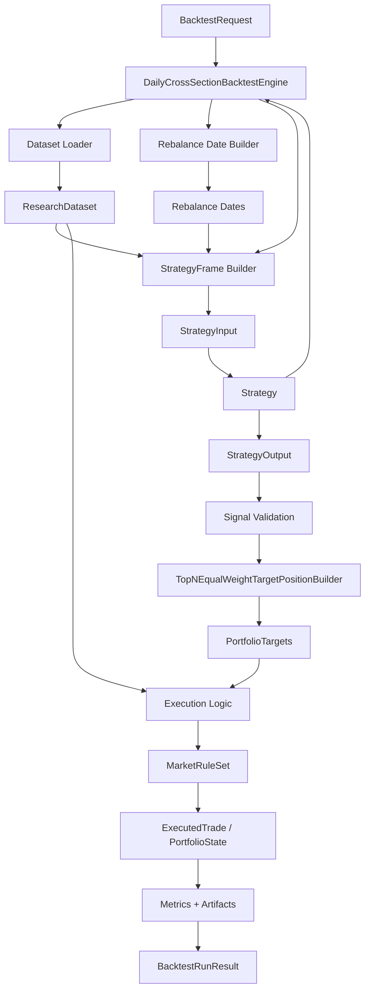

# 策略与回测模块功能详细设计

## 1. 文档目的

这份文档基于当前仓库已有文档、代码边界和开源量化框架常见做法，补齐首版 `strategy-runtime` 与 `backtest-engine` 的实现级详细设计。

它回答 4 个问题：

1. 策略模块首版必须具备哪些行为和能力
2. 回测模块首版必须具备哪些行为和能力
3. 这些能力在代码里应该如何按面向对象方式拆分
4. 哪些能力现在就要做，哪些明确延后

这份文档是 [07-策略接口与回测接口设计](./07-策略接口与回测接口设计.md) 的实现展开稿，不替代 `07`，而是把 `07` 里的概念接口收敛成 Python 落地设计。

## 2. 设计输入与约束

这份设计以当前仓库已有事实为前提：

- 数据底座当前只正式覆盖 `stock`、`trading_calendar`、`daily_quote`
- 当前实现频率只有 `1d`
- 当前研究与回测主线还未开始编码，`modules/engine/` 为空
- 首版策略只负责产出信号，不负责复杂组合优化
- 首版回测只需要支持 `top_n + 等权 + 固定频率调仓`
- 首版正式结果只支持 `next_open` 成交假设
- A 股约束不能散落在策略类中，必须挂在回测侧的规则对象里

因此这份设计刻意不引入以下复杂度：

- 通用订单状态机
- 账户同步与资金冻结
- 风控插件系统
- 多市场统一撮合器
- 高频事件流回放

## 3. 开源项目调研后的取舍

结合 `Backtrader`、`Zipline`、`RQAlpha`、`QSTrader`、`vectorbt` 这几类开源项目，首版需要吸收的不是它们全部表面 API，而是其中更稳定的结构性能力。

### 3.1 需要吸收的能力

| 能力 | 开源项目常见做法 | 当前项目取舍 |
| --- | --- | --- |
| 策略生命周期 | `Backtrader` / `RQAlpha` 常见 `init`、按 bar 执行、结束清理 | 不照搬逐 bar 回调，保留“按交易日横截面生成信号”作为首版主接口 |
| 预计算特征输入 | `Zipline Pipeline` 会在交易前准备横截面特征 | 保留 `features` 入口，让策略既能现场算分，也能消费预计算因子 |
| 信号与持仓职责分离 | `QSTrader` 把 alpha、组合构建、风险拆开 | 首版继续把策略和持仓解释拆开，但持仓解释先固定在引擎内 |
| 回测细粒度产物 | `vectorbt`、`Backtrader` 都会输出订单、交易、权益曲线、统计 | 首版不建明细表，但要输出明细产物文件和汇总指标 |
| 严格的数据可用性约束 | `RQAlpha` / `Zipline` 都强调历史窗口和未来数据边界 | 首版必须显式处理 warmup、下一交易日成交价可用性和前视偏差 |

### 3.2 明确不照搬的能力

| 能力 | 为什么现在不做 |
| --- | --- |
| `on_bar` / `handle_bar` 逐条事件驱动 API | 当前项目是日频横截面研究，逐条 bar 回调会让接口比业务复杂 |
| 内置完整 broker / order / account 子系统 | 首版目标仍是研究与回测闭环，不是模拟盘 |
| 多层组合优化和风险模型框架 | 当前 `top_n + 等权` 足以支撑首版验证，不应提前平台化 |
| 大规模向量化批量参数搜索 | 当前应先把一次回测算对、算稳，再考虑规模化 |

## 4. 首版必须具备的行为与能力

## 4.1 策略模块

策略模块首版必须具备以下能力：

1. 具备稳定的策略身份与版本元信息
2. 具备显式参数校验
3. 能声明自己需要的历史窗口和特征列
4. 能在某个交易日对候选标的做横截面过滤、排序和打分
5. 能输出可复现的信号顺序和解释信息
6. 不依赖数据库、HTTP、系统当前时间等外部状态
7. 同一输入必须得到同一输出
8. 在缺失历史或缺失特征时行为明确

## 4.2 回测模块

回测模块首版必须具备以下能力：

1. 能加载 `dataset_spec` 定义的数据集口径
2. 能基于交易日历生成日频、周频、月频调仓点
3. 能根据策略声明准备历史窗口和可选特征
4. 能校验信号合法性并做确定性排序
5. 能把信号解释为 `top_n + 等权` 的目标持仓
6. 能按 `next_open` 计算成交与收益
7. 能扣减手续费、滑点，并记录换手
8. 能执行 A 股首版最小规则校验
9. 能输出汇总结果与明细产物
10. 能在关键数据缺失时直接失败，而不是静默跳过

## 4.3 对后续扩展的最低留白

首版不单独设计公开的组合构建模块接口。

这和 `04`、`07` 的阶段边界保持一致：当前只需要一套稳定、内置的 `top_n + 等权` 持仓解释规则，不需要为了未来的优化器、行业约束或风险预算先引入一层完整的 `PortfolioPolicy` 抽象。

但首版仍要保留两点最小留白：

1. 不把持仓解释逻辑写进 `Strategy.generate_signals()`
2. 在引擎内部把“信号排序、截断、等权分配、排除原因记录”收口到单独协作件

这样后续如果真的出现：

- 权重上限约束
- 行业约束
- 风险暴露约束
- 波动率目标

再把内置协作件升级为独立组合构建接口即可，不需要反过来修改 `Strategy` 的公开边界。

## 5. 设计原则

## 5.1 接口对象与运行时对象分离

为和当前仓库风格保持一致：

- 用户入口请求、结果摘要、需要序列化落盘的对象使用 `Pydantic`
- 每个调仓日、每个标的都会频繁创建的运行时对象使用 `dataclass(slots=True)`

## 5.2 Python 命名优先

`07` 文档中的概念接口采用 `camelCase`，但当前仓库真实实现是 Python 工程。

这份详细设计统一采用 `snake_case` 命名，并与 `05` 的落库字段约定保持一致。

## 5.3 先做窄接口，再做深实现

首版不追求接口数量多，而追求这几个接口能稳定承载完整回测闭环。

## 6. 模块拆分建议

重新审查后，首版不建议一开始就把回测引擎拆成很多平级模块。

更合理的是先保留 3 个稳定边界：

1. `Strategy`
2. `BacktestEngine`
3. `ChinaStockMarketRuleSet`

其余能力先作为 `BacktestEngine` 内部协作函数或私有类存在，等出现第二种实现时再拆分。

### 6.1 首版最小文件结构

建议首版先落成：

```text
modules/engine/
  strategies/
    __init__.py
    base.py
    models.py
  backtest/
    __init__.py
    models.py
    engine.py
    market_rules.py
```

职责如下：

- `strategies/`：定义策略抽象、策略输入输出对象
- `backtest/models.py`：定义回测请求、结果、运行态对象
- `backtest/engine.py`：收口数据加载、调仓日生成、信号校验、持仓解释、成交、指标、产物输出
- `backtest/market_rules.py`：A 股规则约束

下面这些概念在首版是“职责”，但不要求先做成独立文件或 ABC：

- 数据集加载
- 调仓日生成
- 策略输入 DataFrame 构造
- 信号校验
- `top_n + 等权` 目标持仓解释
- 指标聚合
- 产物写出

只有当这些职责中某一个真的出现第二种实现时，再单独拆文件。

### 6.2 模块关系图

首版更适合按“一条固定回测链路 + 少量可替换协作件”来理解，而不是按一堆平级插件来理解。



可以把这张图读成 4 层：

- 入口层：`BacktestRequest`、`Strategy`
- 数据准备层：数据加载、调仓日生成、策略输入 DataFrame 构造
- 决策与执行层：信号校验、目标持仓解释、执行逻辑、`MarketRuleSet`
- 结果输出层：指标聚合、产物输出、`BacktestRunResult`

各模块关系的关键点如下：

- `DailyCrossSectionBacktestEngine` 是总编排器，本身不承载策略逻辑、市场规则和指标计算细节
- `Strategy` 只消费 `StrategyInput` 并产出 `StrategyOutput`，不直接碰 repository、执行价格和持仓状态
- 数据加载逻辑负责把底层表组织成研究语义对象，策略输入构造逻辑再把它整理成某个调仓日可见的 DataFrame 视图
- 信号校验逻辑负责守住信号合法性和确定性排序口径，不让策略输出直接流入执行
- `TopNEqualWeightTargetPositionBuilder` 是首版内置的持仓解释协作件，负责把信号转成目标持仓
- 执行逻辑负责成交价、手续费、滑点和持仓变化，`MarketRuleSet` 只负责 A 股规则修正与校验
- 指标聚合和产物输出只消费运行结果，不反向影响回测路径

## 7. 策略模块详细设计

## 7.1 核心对象

```python
from __future__ import annotations

from abc import ABC, abstractmethod
from dataclasses import dataclass, field
from datetime import date
from typing import Any, Literal

import pandas as pd
from pydantic import BaseModel, ConfigDict, Field


class StrategyDataRequirement(BaseModel):
    model_config = ConfigDict(extra="forbid")

    required_history_bars: int = 0
    required_feature_columns: list[str] = Field(default_factory=list)
    require_turnover: bool = False


class StrategyManifest(BaseModel):
    model_config = ConfigDict(extra="forbid")

    strategy_id: str
    strategy_name: str
    version: str
    description: str | None = None
    bar_frequency: Literal["1d"]
    long_only: Literal[True]
    default_params: dict[str, Any]
    data_requirement: StrategyDataRequirement


class StockUniverseSpec(BaseModel):
    model_config = ConfigDict(extra="forbid")

    exchanges: list[Literal["SSE", "SZSE"]] = Field(default_factory=lambda: ["SSE", "SZSE"])
    boards: list[Literal["main_board", "chinext", "star_market"]] = Field(
        default_factory=lambda: [
            "main_board",  # 主板
            "chinext",  # 深圳的创业板
            "star_market"  # 上海的科创板
        ]
    )
    include_st: bool = False


class DatasetSpec(BaseModel):
    model_config = ConfigDict(extra="forbid")

    market: str
    bar_frequency: Literal["1d"]
    start_date: date
    end_date: date
    stock_universe: StockUniverseSpec
    filters: dict[str, Any] = Field(default_factory=dict)
    feature_columns: list[str] = Field(default_factory=list)


@dataclass(slots=True)
class StrategyInput:
    trade_date: date
    dataset_spec: DatasetSpec
    params: dict[str, Any]
    frame: pd.DataFrame


@dataclass(slots=True)
class SignalRecord:
    instrument_id: str
    trade_date: date
    signal_side: Literal["long", "flat"]
    score: float
    reason: str | None = None


@dataclass(slots=True)
class StrategyOutput:
    trade_date: date
    signals: list[SignalRecord]


class Strategy(ABC):
    @abstractmethod
    def manifest(self) -> StrategyManifest: ...

    @abstractmethod
    def validate_params(self, params: dict[str, Any]) -> None: ...

    @abstractmethod
    def generate_signals(self, input: StrategyInput) -> StrategyOutput: ...
```

## 7.2 对象职责

### `StrategyManifest`

负责暴露：

- 策略身份
- 版本
- 默认参数
- 数据依赖

它的关键新增点是 `data_requirement`。没有这一层，引擎无法提前知道该准备多少历史窗口和哪些预计算特征。

### `StrategyInput`

表示某个调仓日可见的统一策略输入视图。

约束：

- `frame` 同时包含当前调仓日和所需历史窗口的数据
- `frame` 中不得包含调仓日之后的数据
- `frame` 至少应包含 `trade_date`、`instrument_id`、`open`、`high`、`low`、`close`、`volume`
- 如果有成交额、预计算特征或因子列，也统一作为 `frame` 的列存在
- 当前调仓日横截面可通过 `frame[frame[\"trade_date\"] == input.trade_date]` 取得

推荐组织方式：

- 普通长表列：`trade_date`、`instrument_id` + 数值列
- 或 MultiIndex：`(trade_date, instrument_id)`

无论采用哪种组织方式，首版都以 `pandas.DataFrame` 作为策略公开输入，以便直接复用 `pandas`、`qlib`、技术指标库等生态。

### `SignalRecord`

首版仍只保留：

- `long`
- `flat`

`score` 是唯一排序依据。为保证可复现，当 `score` 相同时，回测引擎必须按 `instrument_id` 升序打破平局。

## 7.3 策略行为约束

所有策略实现都必须满足：

1. `generate_signals` 不做 I/O
2. 不原地修改输入 DataFrame
3. 不依赖类外单例状态
4. 不读取系统当前日期时间
5. 不把仓位控制、订单拆分、成交假设写进策略内部

## 7.4 缺失数据约定

首版明确区分两类缺失：

### 可接受缺失

以下情况允许单个标的不进入策略评分：

- 上市天数不足，无法满足 `required_history_bars`
- 缺失某个策略声明为必需的特征列
- 当前交易日没有足够字段支持该策略计算

处理方式：

- 由引擎内部的 DataFrame 构造逻辑直接剔除
- 同时把剔除原因写入调试明细

### 不可接受缺失

以下情况必须直接失败：

- 回测日期不在交易日历中
- 当前调仓日横截面输入为空
- 已选中标的缺少执行价格
- `next_open` 模式下缺少下一交易日可成交行情

## 7.5 策略示例类型

首版只建议实现两类策略：

1. 单因子排序策略
2. 多因子线性打分策略

不建议首版直接做：

- 依赖复杂状态机的事件驱动策略
- 盘中择时策略
- 需要订单簿或分钟线的策略

## 8. 回测模块详细设计

## 8.1 公开对象

```python
from dataclasses import dataclass, field
from datetime import date, datetime
from typing import Any, Literal

from pydantic import BaseModel, ConfigDict


class BacktestRequest(BaseModel):
    model_config = ConfigDict(extra="forbid")

    id: str
    dataset_spec: DatasetSpec
    strategy_params: dict[str, Any]
    start_date: date | None = None
    end_date: date | None = None
    initial_capital: int
    rebalance_frequency: Literal["daily", "weekly", "monthly"]
    max_positions: int
    commission_bps: int
    slippage_bps: int


class BacktestMetrics(BaseModel):
    model_config = ConfigDict(extra="forbid")

    total_return: float
    annual_return: float | None = None
    max_drawdown: float
    sharpe: float | None = None
    trade_count: int
    turnover_rate: float | None = None
    rebalance_count: int


class BacktestArtifacts(BaseModel):
    model_config = ConfigDict(extra="forbid")

    artifact_dir: str
    equity_curve_path: str
    rebalance_log_path: str
    trade_log_path: str
    position_log_path: str
    summary_path: str


class BacktestRunResult(BaseModel):
    model_config = ConfigDict(extra="forbid")

    request_id: str
    strategy_id: str
    strategy_version: str
    dataset_spec: DatasetSpec
    started_at: datetime
    finished_at: datetime
    status: Literal["success", "failed"]
    error_message: str | None = None
    metrics: BacktestMetrics | None = None
    artifacts: BacktestArtifacts | None = None


@dataclass(slots=True)
class PositionState:
    instrument_id: str
    quantity: int
    sellable_quantity: int
    last_price: int
    last_trade_date: date | None = None


@dataclass(slots=True)
class PortfolioState:
    cash: int
    positions: dict[str, PositionState] = field(default_factory=dict)


@dataclass(slots=True)
class TargetPosition:
    instrument_id: str
    target_weight: float
    score: float | None = None
    reason: str | None = None


@dataclass(slots=True)
class ExcludedSignal:
    instrument_id: str
    reason: str


@dataclass(slots=True)
class PortfolioTargets:
    trade_date: date
    target_positions: list[TargetPosition]
    excluded_signals: list[ExcludedSignal] = field(default_factory=list)


@dataclass(slots=True)
class RebalanceRecord:
    trade_date: date
    candidate_count: int
    selected_count: int
    turnover_rate: float | None = None
    note: str | None = None


@dataclass(slots=True)
class ExecutedTrade:
    trade_date: date
    instrument_id: str
    side: Literal["buy", "sell"]
    quantity: int
    price: int
    gross_amount: int
    commission: int
    slippage: int


@dataclass(slots=True)
class DailyPerformanceRecord:
    trade_date: date
    equity: int
    cash: int
    market_value: int
    daily_return: float | None
    drawdown: float | None


@dataclass(slots=True)
class DailyPositionSnapshot:
    trade_date: date
    instrument_id: str
    quantity: int
    sellable_quantity: int
    last_price: int
```

`BacktestRequest` 不再重复携带 `strategy_id`、`strategy_version`。

首版引擎直接以传入 `strategy` 实例的 `manifest()` 作为单一真相源，再把这两个字段写入 `BacktestRunResult` 和 `summary.json`。

## 8.2 首版必须稳定的接口

重新审查后，首版真正需要稳定下来的公开接口只有：

- `Strategy`
- `BacktestEngine`
- `MarketRuleSet`

它们分别对应：

- 策略逻辑边界
- 回测主流程边界
- A 股规则边界

下面这些能力虽然必须存在，但首版不要求先定义成独立 ABC：

- 数据集加载
- 调仓日生成
- `StrategyInput` 构造
- 信号校验
- `top_n + 等权` 目标持仓解释
- 指标聚合
- 本地产物写出

这些职责更适合先做成 `DailyCrossSectionBacktestEngine` 的私有方法，或 `engine.py` 内部的轻量辅助类。

## 8.3 公开接口

```python
class BacktestEngine(ABC):
    @abstractmethod
    def run(self, request: BacktestRequest, strategy: Strategy) -> BacktestRunResult: ...

class MarketRuleSet(ABC):
    @abstractmethod
    def normalize_target_quantity(self, quantity: int, lot_size: int, side: str) -> int: ...

    @abstractmethod
    def validate_trade(self, trade: ExecutedTrade, position: PositionState | None) -> None: ...

    @abstractmethod
    def update_position_after_trade(
        self,
        trade_date: date,
        trade: ExecutedTrade,
        portfolio: PortfolioState,
    ) -> None: ...

    @abstractmethod
    def roll_position_for_next_day(self, trade_date: date, portfolio: PortfolioState) -> None: ...
```

## 8.4 推荐的首版具体实现类

```text
TopNEqualWeightTargetPositionBuilder
ChinaStockMarketRuleSet
DailyCrossSectionBacktestEngine
```

这些类不是为了“看起来很架构”，而是把当前会变化的职责拆开：

- `TopNEqualWeightTargetPositionBuilder`：当前唯一需要单独点名的内置协作件
- `ChinaStockMarketRuleSet`：当前唯一需要单独抽开的市场规则对象
- `DailyCrossSectionBacktestEngine`：当前唯一需要承接主流程编排的引擎类

其余职责默认先内聚在 `engine.py`。

## 8.5 回测主流程

`DailyCrossSectionBacktestEngine.run()` 固定按以下顺序执行：

1. 校验 `request` 基础字段
2. 调用 `strategy.validate_params()`
3. 读取 `dataset_spec`
4. 根据 `dataset_spec` 和请求裁剪实际区间
5. 生成调仓日期序列
6. 初始化 `PortfolioState`
7. 对每个调仓日构造 `StrategyInput`
8. 调用 `strategy.generate_signals()`
9. 校验信号
10. 用内置 `top_n + 等权` 规则解释目标持仓
11. 在执行阶段应用 A 股规则修正
12. 在执行日撮合成交
13. 记录交易、持仓、权益和换手
14. 处理到最后一个观察日
15. 聚合指标
16. 写出明细产物
17. 回写 `backtest_result`

## 8.6 调仓日生成规则

为避免实现时口径飘移，首版直接固定：

- `daily`：区间内每个开市日都调仓
- `weekly`：每周第一个开市日调仓
- `monthly`：每月第一个开市日调仓

这样做的原因是：

- 规则简单
- 可解释
- 易于和交易日历对齐

## 8.7 首版内置持仓解释

首版不单独暴露公开的组合构建接口。

当前更合理的做法是把持仓解释收口到引擎内部的一个具体协作件，例如 `TopNEqualWeightTargetPositionBuilder`，职责仅限于：

1. 过滤 `signal_side = "long"` 的信号
2. 做稳定排序和截断
3. 生成等权目标持仓
4. 记录未入选标的的排除原因

这样能保持 `Strategy` 纯粹，也能避免首版为了未来扩展提前引入一层完整的 `PortfolioPolicy` 抽象。

## 8.8 首版默认持仓解释规则

`TopNEqualWeightTargetPositionBuilder` 固定使用以下规则：

1. 只保留 `signal_side = "long"` 的信号
2. 按 `score` 降序排列
3. `score` 相同按 `instrument_id` 升序排列
4. 取前 `max_positions`
5. 对入选标的分配相同目标权重
6. 输出 `TargetPosition` 列表
7. 未入选标的目标权重视为 `0`

首版不做：

- 自定义仓位上下限
- 行业中性
- 波动率目标
- 风险预算

## 8.9 执行逻辑

首版执行逻辑只支持一种正式成交假设：

### `next_open`

- 在调仓日收盘后得到信号
- 于下一开市日开盘价成交
- 这是首版默认值

`same_close` 明确延后。

原因很直接：

- 当前 `StrategyInput.frame` 会把当日调仓日数据一并提供给策略
- 如果策略使用了当日收盘信息，再按当日收盘价成交，极易引入前视偏差
- 在没有单独约束“信号生成时点”和“可见字段集合”之前，不应把它作为正式回测模式

## 8.10 A 股规则对象

根据 [03-A股市场适配说明](./03-A股市场适配说明.md)，首版 A 股相关约束必须集中在回测规则对象，而不是写进策略类。

这是首版少数值得现在就抽出来的对象，因为：

- A 股规则明确不应散落在策略里
- 未来切到别的市场时，规则边界天然会变
- 它比“调仓日生成器”或“指标计算器”更有独立演进的必要

建议抽象为：

```python
class MarketRuleSet(ABC):
    @abstractmethod
    def normalize_target_quantity(self, quantity: int, lot_size: int, side: str) -> int: ...

    @abstractmethod
    def validate_trade(self, trade: ExecutedTrade, position: PositionState | None) -> None: ...

    @abstractmethod
    def update_position_after_trade(
        self,
        trade_date: date,
        trade: ExecutedTrade,
        portfolio: PortfolioState,
    ) -> None: ...

    @abstractmethod
    def roll_position_for_next_day(self, trade_date: date, portfolio: PortfolioState) -> None: ...
```

`ChinaStockMarketRuleSet` 首版至少实现：

1. `long_only`
2. 买入数量按 `lot_size` 向下取整
3. 卖出时允许一次性卖出不足一手的剩余股数
4. 当日买入仓位在下一个交易日前不可卖出

以下能力只预留接口，不要求首版实现完整逻辑：

- 涨跌停不可成交
- 停牌不可成交
- 风险警示股票差异化价格限制

## 8.11 明细产物设计

为兼容 `04` 中“交易记录、换手率、回测与研究报告”的验收标准，首版虽然不建明细表，但必须输出本地产物目录。

建议目录：

```text
data/backtests/{request_id}/
  summary.json
  equity_curve.csv
  rebalance_log.csv
  trade_log.csv
  position_log.csv
```

文件职责：

- `summary.json`：本次回测的完整输入快照和汇总指标
- `equity_curve.csv`：每日权益、现金、市值、日收益、回撤
- `rebalance_log.csv`：每个调仓日的候选数、入选数、换手率
- `trade_log.csv`：每笔成交明细
- `position_log.csv`：每个观察日收盘后的持仓快照，必须带 `trade_date`

## 8.12 指标口径

首版至少输出：

- `total_return`
- `annual_return`
- `max_drawdown`
- `sharpe`
- `trade_count`
- `turnover_rate`
- `rebalance_count`

指标分层：

- `backtest_result` 表：至少保存汇总指标
- 本地产物文件：保存每日曲线、每次调仓、每笔交易

`win_rate` 明确不作为首版必出指标。

原因是首版并没有单独定义完整的交易配对、已实现收益归因和持仓成本口径。过早输出 `win_rate`，比不输出更容易制造误解。

如果当前 `backtest_result` 表字段仍不足以承载 `turnover_rate`、`rebalance_count` 等摘要指标，则首版可以先写入 `summary.json`，并把这些字段列为后续 schema 增补项。

## 8.13 错误处理

错误按 3 类处理：

### 输入错误

例如：

- 请求参数非法
- 策略参数非法
- 日期区间非法

处理方式：

- 在回测真正开始前直接失败

### 数据错误

例如：

- `dataset_spec` 非法或缺失必要字段
- 交易日历缺失
- 执行价缺失
- 选中标的缺少行情

处理方式：

- 直接失败
- `backtest_result.status = failed`
- 产物目录中写 `summary.json` 记录失败原因

### 策略错误

例如：

- 策略抛异常
- 信号输出不合法

处理方式：

- 直接失败
- 保留已构造的输入和错误信息，方便复盘

## 9. 与现有数据层的挂接方式

## 9.1 `DatasetSpec`

重新审查后，首版不建议继续沿用 `dataset_spec_id` 这个偏注册表式的命名。

当前项目更合适的做法是：在 `BacktestRequest` 和 `StrategyInput` 中直接传一个 `DatasetSpec` 对象。

这样有几个好处：

- 不依赖还没落地的 `research_dataset_spec` 表
- 不需要先做本地注册表或 ID 映射
- 回测请求本身就是完整、可复现的输入快照

首版建议 `DatasetSpec` 只保留最小必要字段：

- `market`
- `bar_frequency`
- `start_date`
- `end_date`
- `stock_universe`
- `filters`
- `feature_columns`

它回答的是：

- 在什么市场
- 用什么频率
- 看哪段时间
- 哪类 A 股能进入输入
- 进入前做哪些过滤
- 最后给策略哪些列

其中 `stock_universe` 不再使用过于自由的字典，而是固定成按 A 股股票类别表达：

- `exchanges`：`SSE`、`SZSE`
- `boards`：`main_board`、`chinext`、`star_market`
- `include_st`：是否包含 ST / *ST

这样像下面这些范围就都能直接表达：

- 沪深主板
- 创业板
- 科创板
- 沪深全市场但不含 ST

需要注意：

- 当前仓库现有 `stock` 表只有 `exchange`、`status` 等基础字段
- 还没有正式落地 `board` / `is_st` 这类参考标签
- 因此编码阶段如果要真正支持 `stock_universe`，需要先补充股票板块和 ST 标签数据

## 9.2 数据加载职责

首版不强制定义 `DatasetProvider` 抽象。

`DailyCrossSectionBacktestEngine` 内部的数据加载逻辑需要把以下数据拼成一个可供回测使用的内存对象：

1. 标的基础信息
2. 交易日历
3. 日线行情
4. `stock_universe` 定义的股票范围与过滤规则
5. 可选预计算特征

这里的关键点是：

- 策略不直接依赖 repository
- repository 只负责取数
- 引擎内部的数据加载逻辑负责把底层表组织成研究语义对象

## 10. 对 `07` 文档接口的具体收敛

这份详细设计不推翻 `07`，而是做两件事：

### 1. 保留 `Strategy` 的极简公开入口

仍然保留：

- `manifest()`
- `validate_params()`
- `generate_signals()`

### 2. 暂不拆出公开组合构建接口

首版保持 `top_n + 等权` 为引擎内置规则。

只要求：

- 不把持仓解释塞回 `Strategy`
- 用单独协作件收口排序、截断和等权分配
- 为后续扩展保留清晰替换点

### 3. 把复杂度转移到引擎协作对象

不把下面这些能力塞进 `Strategy`：

- 数据装载
- 调仓日生成
- 信号校验
- 组合构建
- A 股规则处理
- 成交与成本计算
- 指标聚合
- 产物输出

这样策略类才会保持窄、纯、稳定。

## 11. 建议的首版落地顺序

建议按以下顺序实现：

1. `strategies/models.py` 与 `strategies/base.py`
2. `backtest/models.py`
3. `TopNEqualWeightTargetPositionBuilder`
4. `ChinaStockMarketRuleSet`
5. `DailyCrossSectionBacktestEngine`

这个顺序的好处是：

- 先把输入输出对象钉死
- 再把唯一需要独立命名的协作件补齐
- 最后把数据加载、信号校验、调仓日生成、指标和产物都先收口在一个引擎类里

## 12. 首版测试清单

实现后至少要覆盖以下测试：

1. 简单动量策略在给定输入上稳定产出相同信号
2. `required_history_bars` 不满足时，标的会被剔除而不是错误入选
3. 同一 `score` 下按 `instrument_id` 打破平局，结果稳定
4. `weekly` 与 `monthly` 调仓日生成符合交易日历
5. `next_open` 模式下缺少下一交易日开盘价时直接失败
6. `long_only` 下不会生成负仓位
7. 买入数量会按 A 股 `lot_size` 向下取整
8. 当日买入仓位在 T+1 前不可卖出
9. 手续费、滑点和换手率计算结果可复验
10. 回测成功后能生成 `summary.json`、`equity_curve.csv`、`trade_log.csv`
11. 同一数据集和参数重复回测，汇总指标和明细产物一致
12. `position_log.csv` 中的每条持仓快照都带有对应 `trade_date`

## 13. 当前明确延后的能力

这份设计明确延后：

- 独立的组合构建模块接口
- `same_close` 正式回测模式
- 多组合策略并行回测
- 多市场规则组合
- 复杂风险模型
- 订单状态机
- 盘中事件驱动撮合
- 分布式参数搜索
- 图形化研究工作台

## 14. 结论

首版策略与回测模块最重要的设计目标，不是把所有未来能力都预埋进去，而是先建立一套：

- 策略只管评分和信号
- 引擎负责数据、调仓、成交和指标
- A 股规则集中在规则对象
- 汇总结果入库，明细结果出产物目录

只要这四点稳定下来，后续再补组合构建、风控和模拟盘时，边界才不会再次漂移。
